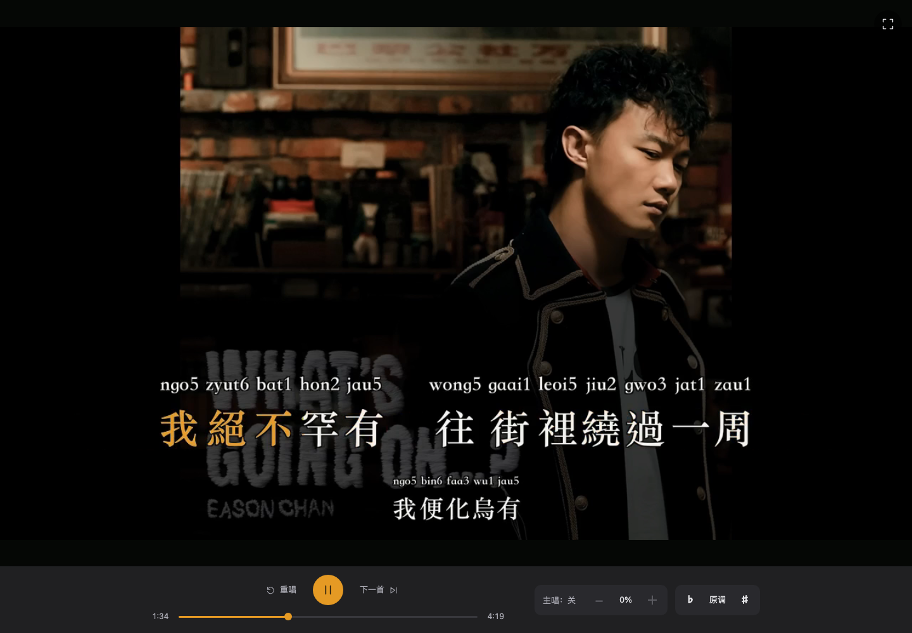
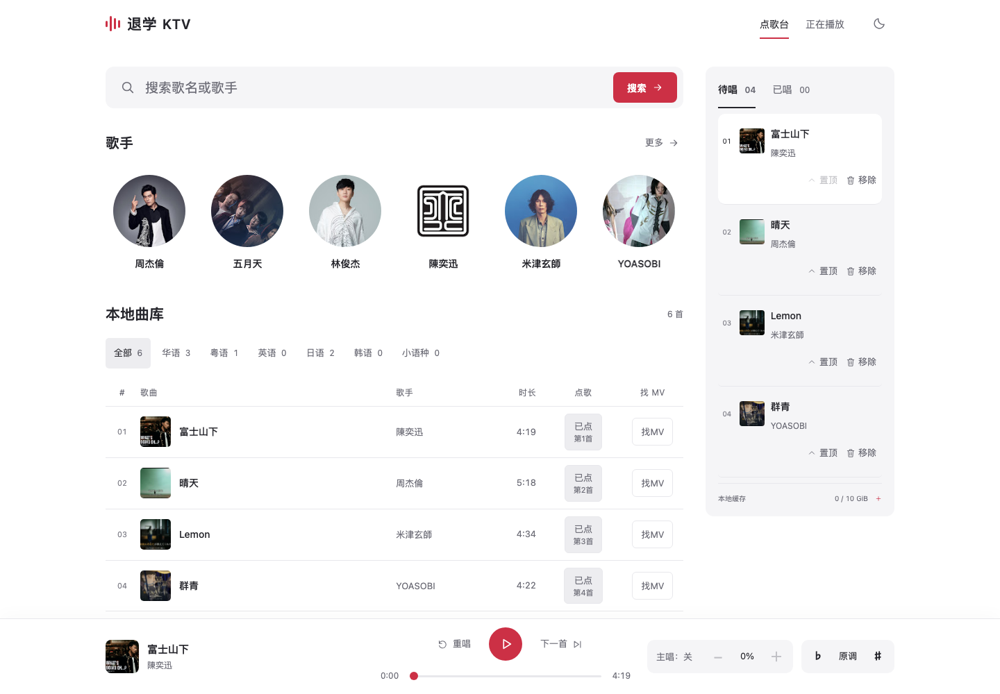
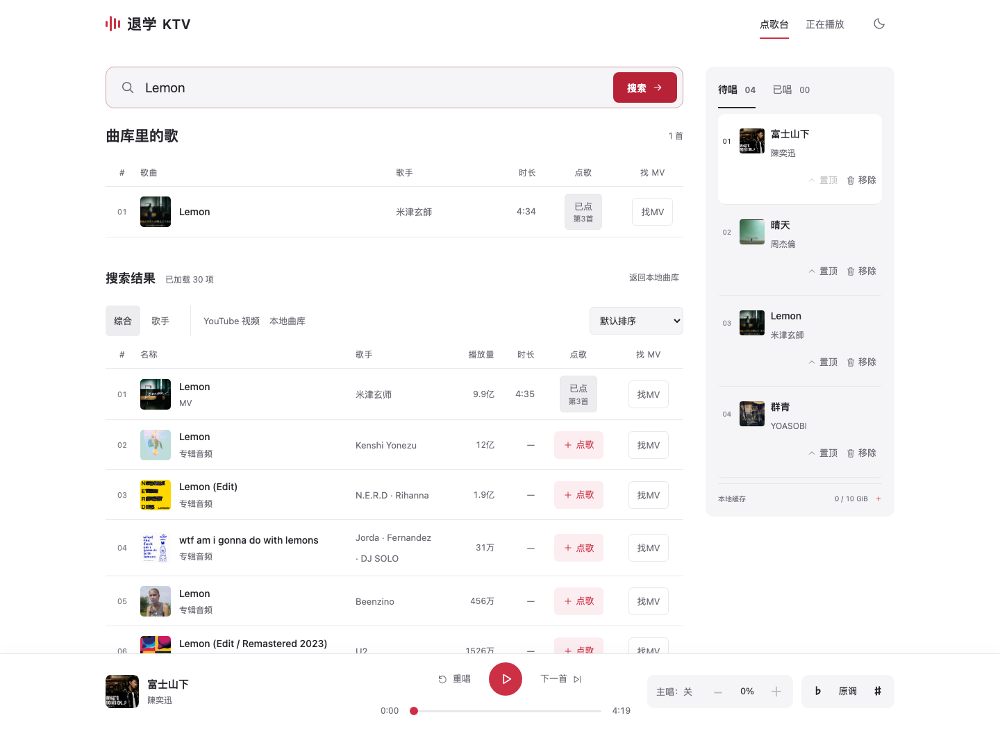
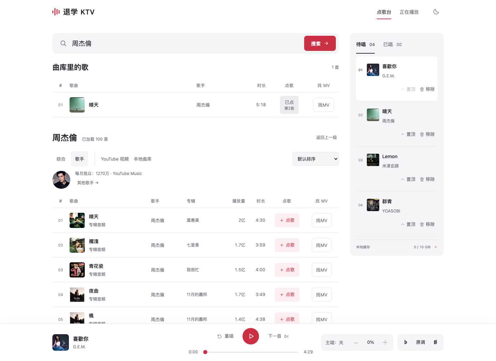
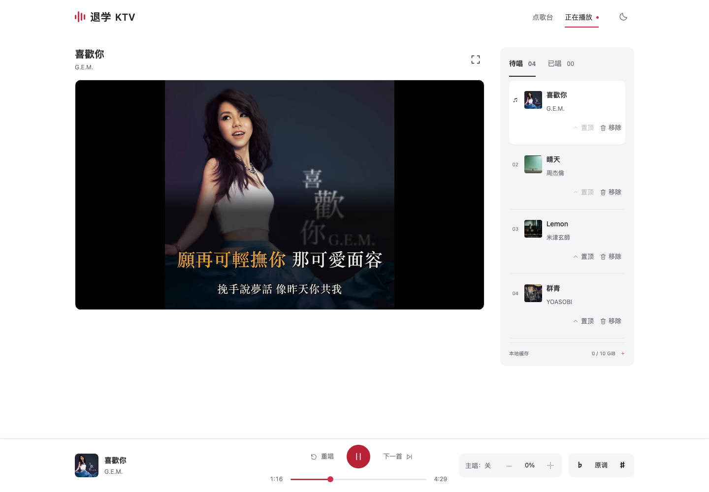
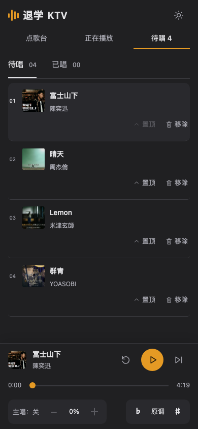
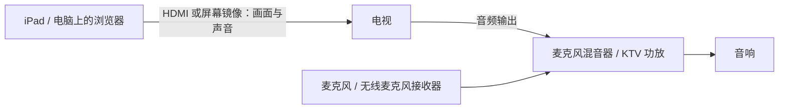

# 退学 KTV · Karaoke

把有权下载和处理的 YouTube 视频变成可以唱的卡拉 OK：网页点歌、后台预处理、共享歌单和自动播放下一首。

也可以把它当成你自己的 KTV 起点：接喜欢的内容来源、改界面、加玩法，自己手搓，或让 Claude Code / Codex 和你一起改。

[快速开始](#快速开始) · [界面预览](#界面预览) · [实际部署](#实际部署把客厅变成-ktv) · [自己动手改](#自己动手改)

## 界面预览

以下为当前界面的实际截图，展示示例曲库、搜索和字幕播放。图中歌曲、封面、视频画面及歌词属于第三方，不包含在本项目的 MIT 授权中；素材出处与授权状态见[截图说明](docs/images/README.md)。截图用于说明功能，不代表逐字起音准确率已经通过人工验收。

### 全屏播放与字幕

琥珀色逐字／词点亮，下一句提前显示。粤语歌词带粤语拼音（粤拼），日文歌词的汉字带平假名注音，读音显示在对应文字上方；底部保留播放进度、主唱音量和升降调。



### 桌面点歌台

按歌手浏览、从曲库点歌，右侧安排待唱顺序。



### 综合搜索

搜索歌名，分别展示曲库里的歌与在线结果，保留不同歌手和版本。



### 歌手搜索

搜索歌手后直接展开作品列表，可切换其他候选并逐首点歌。



### 正在播放

普通播放页同时显示字幕画面、待唱列表和播放控制。



### 手机待唱 · 夜间模式

待唱顺序和播放控制同屏显示。



## 当前功能

- 按歌名查 YouTube Music 歌曲，或找歌手浏览热门歌曲；下拉自动加载更多，支持播放量排序、预览和直接点歌，也保留原始 YouTube 视频搜索和视频链接。后台准备与播放顺序分别维护。
- 自动下载视频，分离背景音乐、伴唱、主唱，生成带字幕的 MV。
- 多语言歌词对齐（中日英保留专用唱歌模型细化）；当前句＋下一句，琥珀色逐字／词点亮，硬切换句，片头歌曲信息和四秒开唱提示。
- 粤语拼音与日文平假名：粤语歌词显示粤拼，日文歌词的汉字显示平假名注音，在生成字幕时完成。
- 暂停、定位、重唱、下一首、全屏；混音后实时升降调，主唱音量按百分比调节。
- 伴奏和伴唱始终开启，主唱 0–100% 加减按钮支持全屏调整，每次 5 个百分点；各设备独立播放；默认 10 GiB 歌曲缓存上限与 LRU 自动回收。
- SQLite 持久化，SSE 推送进度；同一局域网可以用手机点歌和播放。

这是本地单房间 MVP。音频使用原曲和分离音轨，不生成替代音乐。当前有神经网络分离和对齐，普通点歌优先获取已发表歌词，模型负责歌曲信息与声学对齐；无可靠文本时保留音轨，不用识别草稿充当歌词。独立音频验收仍保留 ASR 覆盖率检查。切字精度仍在迭代，行为测试通过不代表音质或切字准确率已经达标。失败样本可先运行音频／字幕回归，通过后再补视频，见 [API](karaoke/API.md#先验证音频)。

## 快速开始

### 让编程助手帮你安装

如果你已经在用 Claude Code（CC）、Codex 或其他编程助手，可以直接把下面这段发给它：

```text
请帮我在本机安装并运行 https://github.com/Trinkle23897/karaoke 。
先读仓库的 AGENTS.md 和 SETUP.md，检查我的系统、Python、显卡和剩余磁盘空间。
按当前硬件准备独立环境、依赖和模型，然后启动网页。
需要 API key 或来源平台登录时，指导我在本机配置。
最后帮我用一首有权处理的歌曲验证点歌、字幕和播放，告诉我以后怎么启动和停止。
```

首次安装需要下载依赖和模型，耗时取决于硬件和网络。只想先看看界面，也可以从下面的最小环境开始。

### 先启动网页

下面是 macOS / Linux 的最小启动方式，需要 Python 3.12；已有仓库时直接进入仓库目录：

```sh
git clone https://github.com/Trinkle23897/karaoke.git
cd karaoke
python3.12 -m venv .venv
.venv/bin/python -m pip install -r karaoke/requirements-api.txt
.venv/bin/python -m karaoke.api
```

打开 <http://127.0.0.1:8746/>，接口文档在 <http://127.0.0.1:8746/docs>。前端不需要构建。

仓库不包含歌曲数据，初次启动曲库为空。上面的步骤可以启动界面和队列；真正处理新歌还需要 [安装说明](SETUP.md) 中的 FFmpeg、Node.js、推理依赖和模型权重。在线识别／元数据整理需要 `OPENAI_API_KEY`；也可配置本地识别模式。

完整环境准备好后，搜索歌曲或粘贴视频链接，点击「点歌」，等待准备完成，再点击「开始唱」。更多操作见[使用说明](karaoke/APP.md)。在启动服务的终端按 `Ctrl+C` 可以停止服务。

## 实际部署：把客厅变成 KTV

除了运行项目的电脑／服务器，可以复用家里的电视和 iPad、手机或电脑，再配麦克风和能把伴奏、人声同时混音的音响设备。电视显示画面，网页播放伴奏，麦克风负责把你的歌声送进音响。



带伴奏输入和麦克风混音功能的一体 KTV 音响，可以把图里的混音器和音响合成一台。已有普通音响或回音壁时，先确认它是否支持麦克风混音；否则需要外接混音设备，并匹配电视、混音设备和音响两端的接口，例如 HDMI ARC、光纤或 AUX。单独的混音器需接有源音响，或经功放连接无源音箱。电视有 HDMI 接口，不代表任意 HDMI 接口都能输出声音；接线可参考[电视音频回传说明](https://helpguide.sony.net/tv/lusltn1/v1/en-003/04-04_01.html)和[电视伴奏与麦克风混音示例](https://www.soundtown.com/products/swm15-pro)，按实际设备的说明书连接。

1. 在 iPad、手机或电脑上打开项目网页，点歌并进入全屏播放。播放设备与运行服务的电脑可以分开；局域网访问配置见 [SETUP](SETUP.md#5-运行配置)。手机／平板使用实时升降调需要受信任的 HTTPS 入口。
2. 用 HDMI 输出，或把整个屏幕镜像到电视，并确认网页声音也从电视输出。本项目的音轨与视频分开播放，仅投送视频文件可能没有伴奏。iPad 可参考 Apple 的[屏幕镜像](https://support.apple.com/zh-cn/102661)与[有线转接器说明](https://support.apple.com/zh-cn/108399)。
3. 将电视的声音送入混音设备的伴奏输入，麦克风或其无线接收器接入对应的麦克风输入，再由音响同时播放伴奏和你的歌声。
4. 用音响／混音器调节自己的麦克风音量；网页里的「主唱」音量调节的是歌曲原唱，实时升降调也只处理歌曲音轨。当前网页不接收或处理你的麦克风声音。

现场人声应走短而低延迟的线路：麦克风直接接混音设备，再到音响；无线麦克风使用配套接收器，尽量避免让混合后的人声再经蓝牙或无线投屏传输。正式开唱前，试一句话检查人声延迟，再对照电视上的字幕与伴奏；投屏不稳定或不同步时，先试有线 HDMI 和有线音频连接。这里是通用接线示意，具体设备组合仍需实测。

## 自己动手改

源码在这里，欢迎把它改成适合自己的 KTV。当前自带的音视频点歌来源是 YouTube / YouTube Music；你可以继续手搓新的入口和玩法，比如：

- 给 B 站、网易云等平台增加点歌入口，或加入本地音视频导入。
- 导入自己的歌单，加收藏、练歌记录，按自己的习惯整理曲库。
- 做适合家里电视的大屏界面，或把手机做成专用遥控器。
- 换主题、字体和字幕样式，增加其他语言的注音，尝试不同的分离或对齐模型。

这些只是改造思路，欢迎按自己的需求继续发挥。也可以直接让编程助手帮忙，例如：

> 请帮这个项目加一个本地音视频导入入口，复用现有的分离、字幕和播放流程，完成后验证原有点歌和播放仍然正常。

做出来觉得别人也会用，欢迎提 PR；只有想法也欢迎开 Issue 交流。开发入口和验证方法见[贡献指南](CONTRIBUTING.md)。

## 文档与指令

- [贡献指南](CONTRIBUTING.md)：开发、测试和安全提交。
- [开发指令](AGENTS.md)：给 Codex 和后续开发者的项目约束。
- [安装与模型准备](SETUP.md)：环境、固定版本的上游源码、权重位置、验证命令。
- [网页使用说明](karaoke/APP.md)：点歌、播放、主唱音量和多设备播放。
- [API](karaoke/API.md)：请求、任务状态、成品下载和环境变量。
- [界面设计](karaoke/docs/design/app.md) · [字幕设计](karaoke/docs/design/subtitles.md)。
- [切字验收](karaoke/docs/word-onset-metrics.md) · [主唱／伴唱验收](karaoke/docs/lead-backing-metrics.md) · [整体验收](karaoke/ACCEPTANCE.md)。
- [自动质量检查](karaoke/docs/automatic-quality.md)：独立参考评分、疑点检查器的漏报／误报和故障注入验证。

## 代码结构

```text
karaoke/
  api.py, room.py, job_schema.py    HTTP、任务队列、共享歌单和准备状态
  pipeline.py, song_sources.py     下载、分离、歌词、对齐、导出
  web/                            原生 HTML / CSS / JavaScript 播放器
  exact_stems.py, three_stems.py   可重组的双轨、三轨母版
  align_*.py, phoneme_progress.py  词／音素对齐与保护规则
  subtitle*.py, render_*.py        字幕布局、点亮、视频导出
  benchmark_neural.py             正式流程使用的分离子进程入口
  benchmark_*.py, dsp.py           其余算法实验与评测工具
  experiments/cjk-onsets-v003/    当前流程仍使用的多窗口对齐代码
  dependencies/                  权重来源与校验值（不含权重）
  models/pretrained/*.yaml        分离模型配置（不含权重）
```

详细入口见[源码导航](karaoke/README.md)。仓库保存代码、测试、配置、文档与上述界面截图；运行所需的歌曲、歌词库、音轨、MV、任务数据库、实验产物、模型权重、大型第三方研究仓库和虚拟环境由使用者另行准备。

## 许可与部署边界

项目自行编写的代码与文档采用 [MIT License](LICENSE)。截图内的第三方素材，以及第三方代码、配置、数据和模型，保留各自权利与许可，见 [THIRD_PARTY.md](THIRD_PARTY.md)。其中包含 GPL 组件和可选的非商业模型；MIT 不替代这些条款，也不代表完整运行环境可以仅按 MIT 分发。

软件许可不授予歌曲、录音、视频、封面或歌词的使用权。下载、处理及分享前，请确认相应内容权限并遵守来源平台条款；开源或非商业使用不自动免除这些要求。

服务默认只监听本机，没有内置账号隔离。远程访问需由部署者保护整个站点及 API；媒体、SSE 和操作接口都在保护范围内。歌曲、歌词和个人凭据不应加入源码发布包。

## 验证

[GitHub Actions](https://github.com/Trinkle23897/karaoke/actions/workflows/tests.yml) 在每次 push 和 PR 时运行全部 Python 与 JavaScript 行为测试，并检查空数据目录启动。测试报告保留 14 天，也可从 Actions 页面手动运行。

准备完整 Python 环境并按 [安装说明](SETUP.md) 拉取 SOFA 源码后：

```sh
PYTEST_DISABLE_PLUGIN_AUTOLOAD=1 PYTHONPATH=karaoke .venv/bin/python -m pytest -q karaoke/test_api.py karaoke/test_room.py karaoke/test_algorithms.py
node --test karaoke/test_player.mjs karaoke/test_pitch.mjs karaoke/test_search.mjs
```

这些测试使用临时文件和合成音频，无需歌曲库、模型权重或 API key。中文发音测试会读取 SOFA 的音素字典，日文发音依赖 pyopenjtalk 字典。
