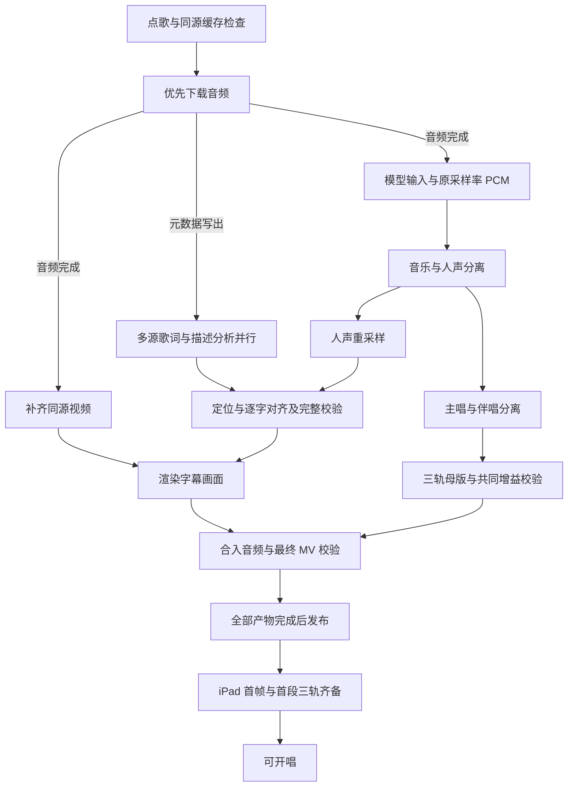

# 余音 · 网页卡拉 OK

## 运行

从工作区根目录启动：

```sh
.venv/bin/python -m karaoke.api
```

打开 <http://127.0.0.1:8746/>。网页与 API 由同一个服务提供，不需要 Node 构建或额外前端服务器。依赖沿用 [API.md](API.md)。

## 使用

1. 输入歌名／歌手，停顿 700 ms 或按回车／「搜索」。默认「全部」展示 YouTube Music 原生搜索的歌曲、专辑、歌手等结果，不额外匹配标题或筛选类型；专辑可点开逐首点歌；切换「歌手」后点一位歌手，浏览其热门歌曲。也可点击单曲的歌手署名进入。默认歌曲在前、专辑其次，其余类型随后；各类保留平台顺序，歌曲中明确标注的现场版靠后，专辑内保留曲目顺序；也支持播放量、已准备优先和歌名排序；播放量只排序已加载结果，未提供计数时不可选择。
   歌曲可以预览并「点歌」；专辑明确标注「专辑」，通过「查看专辑」进入曲目列表，保留专辑与单曲的区别。已读取的专辑曲目复用；「返回上一级」及浏览器后退恢复之前的结果、排序和滚动位置，刷新保留当前搜索页面。「找 MV」进入该歌曲的 YouTube 视频搜索。「YouTube 视频」保留原始整页搜索，「本地」只查看已有曲库。本地已准备歌曲预览缓存 MV，加入时复用现有任务。
   歌曲入队后立即出现在曲库，排队、准备、失败和已准备分别显示。正在处理的歌也可以再点一次，复用同一个处理任务。语言分类依次为华语／英语／日语／韩语／小语种，已知的其他语言归入「小语种」，未知时先留在「全部」；「已准备」只包含成品可用的歌。
2. 也可以直接粘贴 YouTube／Bilibili 单个视频链接，可填写歌名，点击「加入歌单」。
   从搜索结果点歌后立即显示视频标题；下载和歌词整理继续更新歌名、歌手。搜索标题不覆盖后续识别结果，手动填写的歌名仍优先。
   准备时，曲库、歌单与播放页显示各个步骤的实时进度，以及从本次实际开始处理起累计的「已用时」；排队不计时，切换步骤或刷新页面不归零，重试从本次开始时间重新计时。百分比来自实际已完成工作量；无法取得总量的步骤只显示状态，下载则保留已下载大小。并行步骤分开显示。
3. 点底部播放按钮，或歌单中的「现在唱」。首次点击会启用浏览器声音。
4. 右侧歌单分为「待唱」和「已唱」。待唱包含当前歌曲及所有排队歌曲，包括未开始准备和正在处理的歌；可上移、下移、移除，调整顺序同时改变未开始的预处理优先级。
   已唱按最近一次唱过的顺序倒序显示，可按歌名或歌手搜索，点击「再点」加入待唱队尾并复用现有缓存。真正开始播放的歌曲在切歌、唱完或移除时留下一条历史；仅在等待或开场倒计时中跳过的歌不计入。同一首唱多次会保留多次记录。历史在服务端持久保存，刷新或重启不丢失，也不占用待唱队列位置或保护媒体免于正常缓存回收。历史从此功能上线后开始记录，之前已移除的条目无法重建演唱顺序。
5. 底部和播放器画面左上角均有「下一首」，点击直接切歌，全屏也保留。唱完自动进入下一首；若下一首尚未准备好则等待，可再次切歌跳过。加载完成才开始计算播放时间。

底部常驻播放／暂停、重唱、下一首、人声模式和升降调，浏览点歌页时也能直接操作。播放器另提供全屏与各声部音量。快捷键：空格暂停／继续，`N` 下一首，`F` 全屏；输入文字时不会触发。

曲库、搜索结果、预览和链接点歌成功后，原位显示「已加入 · 第 N 首」，随队列调整更新；已在待唱中的歌曲不会因连续点击重复加入。移出待唱后恢复「点歌」，需要重复演唱可在「已唱」中使用「再点」。点歌请求失败后可直接重试。

新歌自动保存视频封面，获取不到时截取 MV 画面；两者都失败才显示歌名首字占位，封面失败不阻止歌曲准备。封面随歌曲纳入缓存上限与 LRU 回收，浏览封面不会刷新歌曲的最近播放／使用时间。

全屏视频下方也有可拖动的进度条、已播时间和总时长。它与普通视图复用同一条时间轴，退出全屏后继续在底部控制栏显示。
全屏控制区底部只占两行：上面一条完整进度条，下面并排三个音量滑杆；人声模式和升降调移到画面右上角，退出后返回底栏。

搜索只读取音乐／视频元数据，不下载完整视频、不创建预处理任务；点歌才开始准备。歌曲、歌手、歌手热门列表和 YouTube 视频搜索按平台原生分页加载，滚到列表末尾自动追加下一页，也可点击「加载更多」。显示「已加载」数量，到底后停止；加载失败保留已有结果并提供重试，搜索过期时可重新搜索。切换关键词或歌手会取消旧请求；保留不同版本和同名歌手，由用户选择。热门顺序来自 YouTube Music 歌手页，不代表 KTV 点唱统计。「YouTube 视频」同样保留平台顺序，仅将明确标注的现场版后置，不按关键词、认证、类型额外筛选，也没有 3 条限制。B站不再参与搜索。失败可重试，空结果与搜索失败分别显示。预览使用官方嵌入播放器，不自动播放；有些视频不允许嵌入，可用旁边的原站链接观看。

### 三种声音模式

- **保留伴唱**：背景音乐＋伴唱，默认模式。
- **纯伴奏**：只放背景音乐。
- **原唱**：三条分离音轨合播，供跟唱和找旋律，播放使用短段无损压缩音频。

三条音轨在一个 AudioContext 中同步调度，切换模式只调整增益，不重启歌曲。原始 float64 母版仍可通过 API 下载。字幕复用已经对齐、渲染好的 MV；这一版没有新增字幕算法，也没有接入 Codex。

### 独立音量

播放器和全屏视图都提供 **伴奏、伴唱、主唱** 三个 0–100% 滑杆；0% 就是静音。主唱指分离出的原唱主旋律，不是麦克风音量。三个滑杆独立生效，底部总音量继续控制整体响度。

拖动立即生效，不重新加载音轨，不改变播放位置。设置保存在房间中，遥控页面可以同步调整，换歌和重启后保留。三个声音模式仍是快捷预设，点击时会重设三个滑杆；手动调整后显示自定义状态。

### 实时升降调

底栏的 `♭` / `♯` 每次降低／升高一个半音，中间显示当前值，点击即可恢复原调。范围 -6 至 +6；普通视图、全屏与遥控页均可操作，设置与房间一起保存。

三个声部混合后共同经过本地 Signalsmith Stretch AudioWorklet，不改变播放速度，不重新下载或生成音轨，三个音量仍可独立调节。原调使用带等量延迟的原始音频通道，原调或暂停时跳过变调 DSP；启用升降调时恢复处理，切换时短暂交叉淡化。当前 160 ms 分析窗带来 200 ms 处理延迟，播放页的视频、亮字与进度使用补偿后的可听时间，避免字幕领先。暂停或定位时关闭输出并清除处理器里的旧音频。

播放设备需支持 AudioWorklet，并通过 localhost 或 HTTPS 打开；同一 Wi-Fi 手机可继续通过普通 HTTP 遥控电脑的播放页。数值测试覆盖双声道三音混合、0 / +3 / -2 / +6 / -6 动态变调和处理延迟，不代替整首歌曲的主观音质验收。

### 本地缓存上限

在歌单底部展开 **本地缓存**，可看当前占用、修改容量上限。默认 **10 GiB**，设置保存后立即应用并持久化。初次部署也可用 `KARAOKE_CACHE_MAX_GIB` 指定默认值；已有设置以数据库中保存的值为准。

- 容量包括服务管理的歌曲下载、预处理中间文件和成品。完成后自动移除中间文件，只保留成品与少量日志。
- 超过预算时，先按最近使用时间回收可恢复的字幕 MV，保留计算过的三条音轨、试听音频、字幕时间轴和封面；视频都回收后仍不够，再按 LRU 回收整首歌。点歌、播放和读取媒体会刷新使用时间；浏览曲库不会。
- 正在处理、仍在待唱列表、正在通过 HTTP 下载的歌曲受保护。暂停的当前歌曲也受保护。
- 仅回收视频的歌曲显示「待补视频」。再次点歌复用同一任务，只下载原视频、核对音频指纹、用保留的音轨和时间轴重新合成字幕 MV，不调用分离、ASR 或对齐模型。仍需下载和视频编码的时间。补视频失败保留音轨和字幕，可重试；若来源音频已改变，明确报错，不能把旧时间轴套到新版本。
- 完整回收后仍保留歌曲信息，下次点歌需要重新准备。不具备恢复元数据的旧缓存只能完整回收。
- 空间不足以容纳受保护歌曲时，禁止把上限降到其占用以下。新任务准备空间不足时会明确失败，可移除待唱歌曲或释放空间后重试。
- 预处理期间每秒检查预算，预留最多 256 MiB 写入余量及 1 GiB 系统可用空间；超额时终止该任务并清理临时文件。这是应用级预算，突发写入可能短暂超额，不是文件系统硬配额。

这个上限只管理 `KARAOKE_DATA_DIR` 中的任务歌曲文件；模型权重、旧实验目录和 SQLite 元数据不计入，也不会自动删除。

### 遥控点歌

`/?remote=1` 使用同一歌单，可以点歌、排序和控制播放，不播放卡拉 OK 音轨；主动打开的视频预览仍可在手机播放。保持一个普通页面作为播放屏，其余设备使用遥控页面。

默认只监听本机。若明确需要同一局域网内的手机访问，可以启动：

```sh
KARAOKE_HOST=0.0.0.0 .venv/bin/python -m karaoke.api
```

手机访问 `http://电脑局域网IP:8746/?remote=1`。这是单房间应用，未实现账号和独立房间，局域网中可访问该地址的人都能操作同一歌单。

## 状态与恢复

日常点歌并行查询 LINE MUSIC、LRCLIB、网易云和同一视频的 YouTube Music 歌词；视频简介中明确发布的歌词可作为第五路候选。先匹配歌名、歌手和版本，再交叉比较正文。比较时忽略署名、繁简体、标点与换行，保留词序和重复唱段；至少两个不同来源的全文一致、且没有同票数的冲突组时优先采用其中一份原文；否则保留可信来源原文与差异，继续由声学模型对齐，不拼接不同版本。已知同一歌词出版方只计一次；不同网站仍可能互相转载，因此一致只是文本证据，不保证录音版本或起音准确。来源链接、文本哈希及差异保存在 `lyric-crosscheck.json`，单站不可用不影响其他站点，登录限制和 429 退避会跨任务保留。完全找不到可用文本时保留音轨与诊断并报错，不采用猜测稿。视频标题中的明确歌手／曲名署名可直接用于检索，上传者不冒充歌手。用户提供或已核对的歌词保持原有入口。

中英文并列、英文在前和括号内的译名都参与歌词身份匹配；已知歌名／歌手时仍检查简介中的歌词。优先选择同一录音，找不到时允许同曲同歌手的录音室或其他现场版本提供纯文本，时长、现场地点等差异记入 `recording_mismatches` 和统计中的 soft fail；只对当前音频重新对齐，不采用其他版本的时间戳。严格 ASR 验收仍保留原录音及覆盖校验。全文未完全一致时，至少三个不同出版方的相近正文可优先于孤立候选，但状态仍是有差异，不算全文核对通过，也不拼接歌词。

找不到可靠歌词时保留音轨和诊断，任务报错，不再用 ASR 猜测稿生成字幕。“纯音乐，请欣赏”“暂无歌词”等整份占位文案不作为歌词；继续检查同来源的后续候选，网页实体还原后再处理正文。

直接对齐出现坏句时，只重试连续坏句及相邻的有效句，音频窗口不超过 45 秒，每块最多 8 次；候选必须文字完整、时间有效且不与保留的邻句冲突，只替换坏句。没有邻句定位或窗口过长时保留原因，供进一步诊断。逐字细化失败也不丢弃音轨：优先复用已有的字词时间，失败词组在已有起止时间内匀速扫亮；播放时不额外显示“估算”提示。完整歌词采用局部高亮回退时记 soft fail；仍有歌词行无法定位或全曲没有可用字幕时记 hard fail，不显示“已准备”。可用字幕、原始字词和修复诊断继续保留，不丢弃已有工作。这些回退不计为逐字验收通过；独立音频回归中的 ASR 验证仍单独运行。

新视频下载和音频补画面最多选择 720p，继续单独获取最佳可用音频。已有来源缓存直接复用；旧成品按已记录格式恢复时仍须核对原始音频，避免换源后与保留音轨错位。

播放前同时等待当前段的三条音轨解码和视频首帧可用；视频失败或超时不会提前启动演唱时钟。切歌后，旧视频的加载事件不能放行新歌。

设置 `KARAOKE_PREPARATION_CONCURRENCY=none` 后不限制在途歌曲数，所有已点歌曲进入阶段流水：下载、分离、识别／对齐、音轨封装和视频编码各有共享工位，不同阶段可同时工作。尚未拿到工位的任务按当前待唱歌曲、歌单顺序排序；调整顺序不打断已开始的步骤。等待任务显示等待状态，不伪造进度。共享缓存仍受原有容量限制。

普通点歌先获取最佳音频。下载器写出来源元数据时即启动歌词查询，不等传输或封面完成；明确歌名、歌手时，描述分析与多源歌词查询并行，最后仍汇总完整证据。音频完成后即可解码和分离，同源视频在另一分支下载；新下载返回的媒体信息直接用于取视频，不重复解析同一网页。已有完整媒体继续复用。

缺少歌名或歌手时，先按视频 ID 读取 YouTube Music 的结构化信息和歌词；不要求先判断原唱或翻唱。平台信息仍不足才让模型补字段，简介歌词作为独立候选保留。歌词网络响应按实际请求缓存；真实时长与预估不同只重新选择候选，已读取的正文不重复下载。来源的登录要求和限流仍在真正联网时生效，不能从共享退避记录继承另一首歌的身份。

原采样率音频仅完整解码一次，保存带来源与内容哈希的临时 float64 PCM，供两次母版封装复用；模型输入格式保持不变。首轮人声就绪后，主唱分离、两轨母版封装和对齐用重采样各自开始；三轨封装只等待所需音轨，对齐只等待歌词与重采样人声。最终 MP3 最多两路并行编码、完整解码检查；任一轨削波时仍整组统一调整增益。中间两轨不编码试听 MP3，也不生成普通点歌用不到的 ASR MP3。

网页只生成使用中的三条 MP3 分轨，不额外生成合成的 `karaoke.mp3`；共同增益仍计算原音乐、各分轨与 KTV 混音的峰值。独立封装工具默认仍可导出合成试听文件。同源补画面直接用于字幕渲染，不再把原音频装入中间视频再拆掉；仍核对来源和时长，最终混入已验证的分轨并完整解码成品。

各对齐阶段只追踪自身代码及依赖，末端修复变化不会让上游识别缓存失效。同一进程内模型哈希只计算一次。个别歌词行被模型改写时，先在已定位邻句之间重试原文；局部修复不足时才扩大到整个块，并保留已得到的有效结果。

最终字幕和源视频齐备即可渲染画面，与剩余音频封装并行；共同增益确定后合入音频，视频流直接复制，不二次压缩。最终 MV 仍须通过全长解码与时长检查。所有必需产物校验结束后才显示已准备，iPad 仍播放预先完成的字幕视频。

已取得的同源歌名、歌手、语言和时长保存在任务数据库，重建任务时立即继承；媒体被 LRU 回收也不退回“新点的歌”。已校验的元数据模型结果及输入指纹一并保留，匹配时直接复用；下载地址过期需刷新时，不把它当作歌曲身份丢失。



- SQLite 保留歌单和任务，页面通过 SSE 接收更新与断线重连快照，不轮询。
- 正常关闭服务时暂停歌曲；重新打开网页可能需要点击启用声音。
- 移除歌单项不会立即删除媒体；它会解除该歌曲的缓存保护。已提交的预处理继续完成，缓存随后可按 LRU 回收，失败项可以重试。
- 「首次准备」表示完整可播放文件尚不存在；历史实验的元数据、封面仍可以展示，但不会冒充现成伴奏。
- 同一来源有多次任务时，曲库优先展示文件完整的成品，其次展示仍可补回视频的成品；较新的预下载、失败或处理中记录不会盖掉它们。移出已点歌只解除缓存保护，回收仍按共享容量和最近使用时间进行。
- 自动歌词可能识别错误，网页会提示；预处理失败与正在等待会分别显示。
- 当前是本地单房间 MVP，浏览器只保留当前和下一段的三轨解码音频（每段 8 秒）。不是在线多人隔离服务，也暂不包含麦克风效果器和评分。

## 验证

```sh
PYTEST_DISABLE_PLUGIN_AUTOLOAD=1 PYTHONPATH=karaoke .venv/bin/python -m pytest -q karaoke/test_api.py karaoke/test_room.py karaoke/test_algorithms.py
node --test karaoke/test_player.mjs karaoke/test_pitch.mjs karaoke/test_search.mjs
```

覆盖预处理和播放顺序、重复点歌复用音轨、旧结束事件、等待加载、暂停／定位、混音保持时间、取消过期音轨加载、SSE 推送和断线清理。浏览器实测记录保留在原开发工作区的 `experiments/app-v001/`，未随源码上传。

### 平板播放

播放页按需读取现有母版的 8 秒片段，统一应用成品的防削波增益，以 24-bit FLAC 传输；保留原采样率与声道，不重跑分离、歌词、对齐或视频渲染。服务器只做短段读取和 CPU 压缩，不调用 GPU。MP3 试听下载仍保留。

客户端最多缓存当前段和下一段。三轨同时按同一个 AudioContext 时钟调度；段边界带有重采样余量，播放时裁掉重叠部分。拖动进度会按需加载对应片段；一轨未到齐时三轨一起等待，房间时钟冻结在共同边界，加载完成再恢复。网络吞吐量需求比 MP3 更高，但远低于直接传输浮点 WAV；这项改动减少的是整首解码的启动开销和内存占用，不是降低所有场景的带宽需求。
