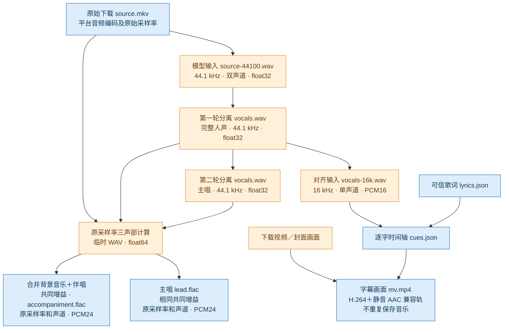

# 普通点歌：处理与存储

蓝色：成功后保留。橙色：处理中使用，成功后回收。箭头表示数据输入。

播放／预览：底轨＋主唱百分比 × 主唱轨，共用一个音频时钟，静音视频跟随。最终成品与歌词来源、必要诊断保留；两个无消费者的分离补轨不生成。失败待重试保留有用检查点，成功后不保留分离 WAV。再次点歌直接复用成品，只有明确重新准备才重跑处理。

最终封装直接复制视频流，保留帧率、画面和时间戳；加入 48 kHz 双声道静音 AAC，供 iPad 原生媒体管线使用。实测 181 秒视频只增加约 121 KiB。独立 FLAC 承载全部可听声音，不调整歌词或增加整体 offset。存量视频可仅重封装，无需重跑分离、对齐或字幕渲染。

独立严格音频验收仍保留三轨 float64 WAV、三轨 MP3 与字幕，不使用普通播放的两轨存储布局。
